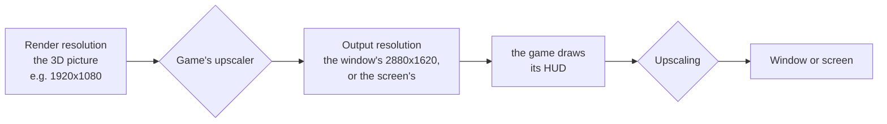
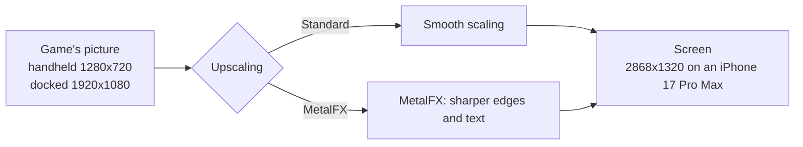
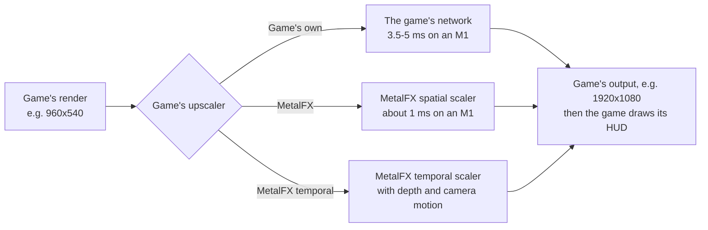
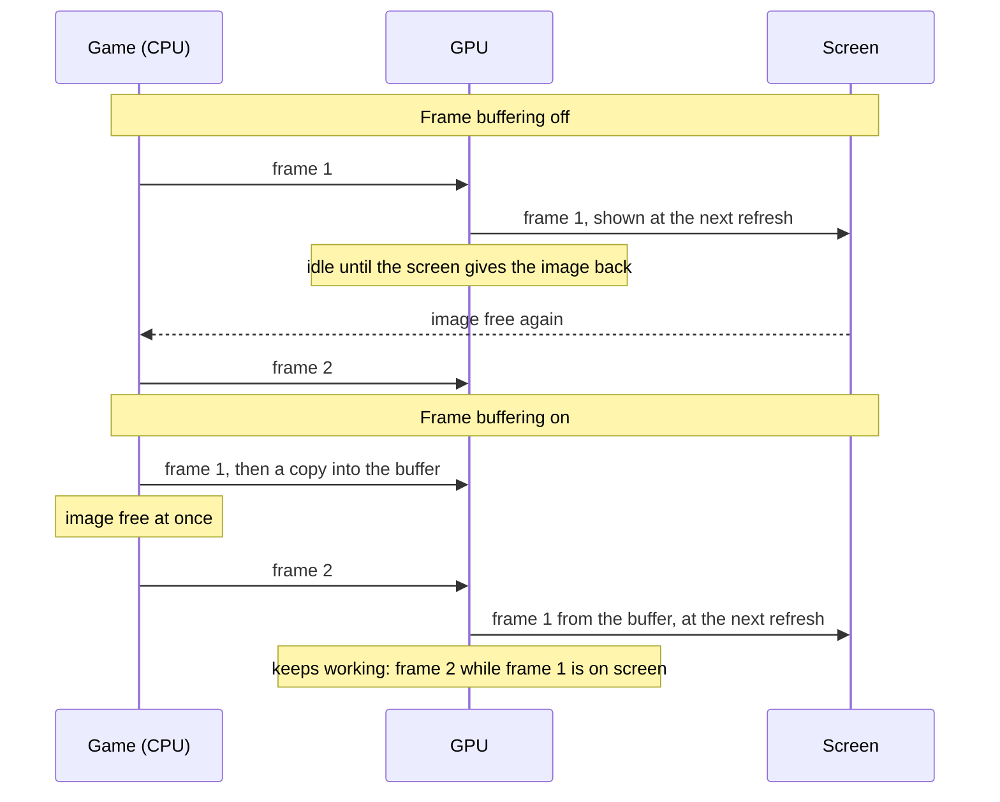
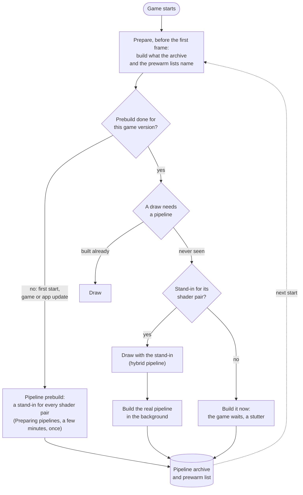
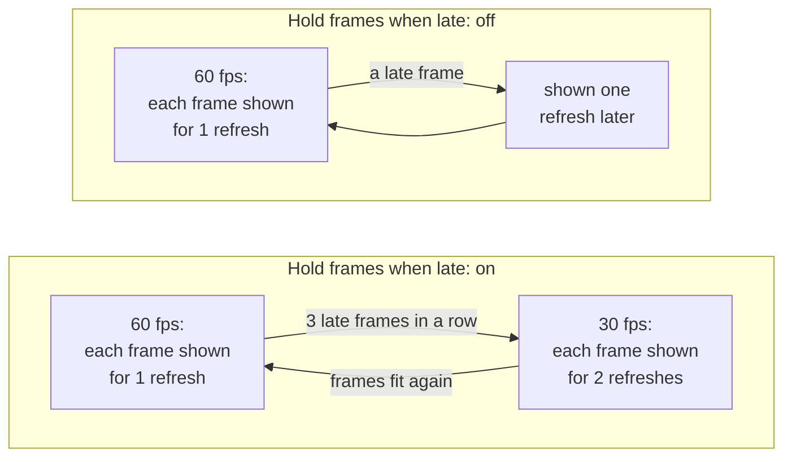

# Settings

The screen before the game starts shows the settings the game supports. A setting that only matters while another is on appears under it and disappears when that one is turned off. Tap **Play** to start; the app remembers your choices for the next start. On the iPhone all settings are on one scrollable screen, under **Game**, **Controls** and **Performance**. Tap a menu or move a slider there; no settings page needs opening. **Upscaling** is in **Game**, beside **Console mode**. A Mac app shows the same settings in a [window of its own](#the-mac-settings-window), which groups the picture's settings under [Resolution](#resolution), [Effects](#effects), [Frame rate](#frame-rate-mac) and [HDR](#hdr). This page follows that order.

- [Tested defaults](#tested-defaults)
- [Game](#game): [Frame rate](#frame-rate), [Render scale](#render-scale), [Console mode](#console-mode), [Game language](#game-language), [Picture](#picture), [Picture shape](#picture-shape), [Frame-rate counter](#frame-rate-counter)
- [Resolution](#resolution): [Upscaling](#upscaling), [Game's upscaler](#games-upscaler), [Output resolution](#output-resolution), [Render resolution](#render-resolution), [Dynamic resolution](#dynamic-resolution), [Softest](#softest)
- [Effects](#effects): [Effects resolution](#effects-resolution), [Shadow resolution](#shadow-resolution), [Shadow map size](#shadow-map-size), [Anisotropic filtering](#anisotropic-filtering), [Trilinear filtering](#trilinear-filtering)
- [Frame rate (Mac)](#frame-rate-mac): [Frame rate mode](#frame-rate-mode), [Frame interpolation](#frame-interpolation)
- [HDR](#hdr)
- [Controls](#controls): [Touch feedback](#touch-feedback), [Game rumble](#game-rumble), [Rumble strength](#rumble-strength), [Rumble cutoff](#rumble-cutoff)
- [Performance](#performance): [Frame buffering](#frame-buffering), [Metal 4 pipelines](#metal-4-pipelines), [Pipeline prebuild](#pipeline-prebuild), [Encode thread](#encode-thread), [Hold frames when late](#hold-frames-when-late), [Performance HUD](#performance-hud), [Reset to tested defaults](#reset-to-tested-defaults)
- [The Mac settings window](#the-mac-settings-window): [Display mode](#display-mode)
- [In-game menu](#in-game-menu)
- [TV](#tv)
- [Settings in a file](#settings-in-a-file)

## Tested defaults

Each game comes with the settings it was tested with: its profile in this repository says, for example, that Breath of the Wild runs with Frame buffering and Metal 4 pipelines on, because that combination held a steady 60 fps on an iPhone 17 Pro Max. Those are the defaults the settings screen shows the first time.

When you change a setting and tap **Play**, the app keeps your choice, also when a later build of the app ships other defaults. A setting you leave at its default is not stored: it follows the defaults of the build you have, so a newer build's tested settings reach you without doing anything. **Reset to tested defaults** at the bottom sets every setting back to its default, and **Play** then forgets your choices, so the game's defaults apply again. For testing, a line in `Documents/env.txt` overrides any setting ([Settings in a file](#settings-in-a-file)).

A Mac app carries the same list (`Contents/Resources/dm/launcher.json`), without the iPhone's own Frame-rate counter and Touch feedback, for a front end that starts the app with the chosen values ([Front ends](frontends.md)).

## Game

### Frame rate

Games whose speed the app controls (Breath of the Wild, Tears of the Kingdom and a few others) offer **30 fps** or **60 fps**. 60 is smoother; 30 is what the Switch ran and uses less power, so the phone stays cooler and the battery lasts longer. The game runs at real speed either way.

On a Mac, a game checked at that speed (Fire Emblem Fortune's Weave) also offers **120 fps**. It needs a screen that shows 120 Hz, and uses more GPU and power. When frames do not fit, during movies, or on a slower screen, the game drops to 60 for a while, so it keeps its real speed. If you see the frame rate move between 60 and 120 and would rather it stayed still, choose 60.

### Render scale

The size of the 3D picture, from 50 to 100 %. Below 100 % the size is fixed there and the game's own dynamic resolution is off; 100 % keeps the game's own. Lower can be lighter on the GPU but is blurrier; the HUD and text keep their sharpness. Only games the app can scale offer it.

### Console mode

**Docked** renders at the Switch's TV resolution, **Handheld** at its lower handheld resolution, which is lighter on the phone and can give a higher frame rate.

### Game language

The game's own languages. The app was packed with one of them; pick another here without repacking. A game packed from a dump or a NUP may come without its list: every language is offered then, with a note, and a game that lacks the one you pick may show another.

### Picture

iPhone and iPad. **Fit**, the default, shows the game's picture (16:9, or the taller one of [Picture shape](#picture-shape)) as large as it fits, with black bars where the screen has another shape. **Fill** enlarges it until it covers the whole screen and crops what lies outside; nothing is stretched. An iPhone loses some of the top and bottom, an iPad some of each side, so health bars, subtitles or maps near the edges can be cut off. A picture that fills the screen without cropping needs a patch for each game that renders a wider view. Fill applies in landscape; in portrait the picture stays fitted above the controls, and on a TV it is always fitted.

### Picture shape

Games whose profile supports it (Breath of the Wild, Animal Crossing: New Horizons). **iPhone Duo screen (1.43:1)** renders a taller picture of the Duo's own shape: the sides of 16:9 with more above and below, and the HUD at the screen's edges. **16:9** is the Switch's picture. The taller picture has about a quarter more pixels, so it runs a little slower and warmer.

### Frame-rate counter

Shows the frames per second at the top left.

## Resolution

How large the game draws its picture, and how it gets to the screen. On the iPhone, **Upscaling** and **Game's upscaler** are under **Game**; the Mac window's Advanced settings put them under **Resolution**, with the settings below that only the Mac has (Donkey Kong Bananza), in the order the picture takes:

- **Render resolution** is how much smaller than its output the game draws its 3D picture: the output divided by a rate. Each option shows the size it gives for the console mode and output resolution chosen, such as **Quality (1.5) · 1920 × 1080**.
- **Dynamic resolution** lets that size drop when frames run late, down to **Softest**, and come back. **Render resolution** is then the sharpest it ever draws.
- The line under the section sums it up: *Renders 1920 × 1080 to 1707 × 960, upscaled to 2880 × 1620.*
- **Effects** and shadows can stay at full size whatever you pick ([Effects](#effects)).

Each of the Mac-only settings changes the game's code when the game starts. The game log names the result in one line: `resolution: docked, output 2880x1620 …; upscale rate 1.5 (sharpest) to 1.6875 (softest), dynamic, start 1.5 (…); scene 1920x1080 to 1707x960; upscaler metalfx-temporal, on at the sharpest; …`.

### Upscaling

A game that renders below the screen's resolution is scaled up to the screen. **Standard**, the default, scales smoothly; **MetalFX** uses Apple's MetalFX upscaler, which sharpens edges and text as it scales.

Breath of the Wild renders 1280x720 in handheld mode. Docked it renders its world at 900p and scales that to 1080p itself, before the app sees the picture. MetalFX works in either mode: handheld saves the most GPU time and heat, docked looks sharper than smooth scaling. Rendering at the screen's resolution stays the sharpest picture, where the GPU can afford it.

- **When to change it:** turn it on if the picture looks soft and the device has GPU time to spare: on a Mac, or on an iPhone in handheld mode at 30 fps. For long sessions at 60 fps on an iPhone leave it at Standard.
- **Cost:** more GPU time each frame, which can increase heat on an iPhone. [Breath of the Wild's measurements](../dm/games/01007EF00011E000/README.md#upscaling-current) cover Mac and iPhone; the matching iPhone Standard run and MetalFX's share of the thermal cost remain unmeasured. Nothing changes while the game's picture is as large as the screen. Unsupported devices and sizes use Standard scaling.
- **On the Mac:** choose **MetalFX** under **Upscaling** in the [settings window](#the-mac-settings-window)'s Advanced settings (under **Resolution**), or set `DM_PRESENT_UPSCALE=metalfx` in its `env.txt` (off by default). It helps in a large window or on a 4K screen.

### Game's upscaler

Shown only for games that upscale their own picture with a network of their own before the app sees it: agl's NDSR network, in Donkey Kong Bananza and Splatoon Raiders. **Game's own**, the default, keeps the game's upscaler. **MetalFX** replaces it with Apple's MetalFX spatial scaler: the same input and output sizes, at a fraction of the GPU time, but Apple's scaler's picture rather than the game's. **MetalFX temporal** uses MetalFX's temporal scaler instead, which also takes the scene's depth and the camera's movement and blends each frame with the ones before: steadier edges and less shimmer, for about 2 ms of GPU time a frame on an M5 Pro. The game does not jitter its camera, so on its own it smooths rather than adds detail; [Anti-aliasing (jitter)](#anti-aliasing-jitter) adds the jitter. It needs the game's camera in its profile (Donkey Kong Bananza has it); a frame without it, or another game, gets the spatial scaler.

- **When to change it:** when the game falls short of its frame rate in busy scenes because of GPU time: Donkey Kong Bananza's upscaler is the largest single piece of a heavy frame on an M1 (3.5-5 ms of about 24 in handheld mode). Compare the look side by side before keeping it.
- **Cost:** none in GPU time (it saves 2.5-4 ms a frame in that case); the picture is Apple's scaler's rather than the game's. Frames where the game renders at its output size are not upscaled and keep the game's shader either way. Devices without MetalFX keep the game's upscaler.
- **Not the same as [Upscaling](#upscaling):** that one scales the finished picture, HUD included, to the screen; this one replaces the game's own step inside the frame. Both can be on.

### Anti-aliasing (jitter)

Experimental, shown under **Game's upscaler** while it is **MetalFX temporal**, for games whose profile names the blocks that hold their camera (Donkey Kong Bananza). **On** moves the game's 3D camera by a different fraction of a pixel each frame, in the GPU's copy of its matrices only, and tells MetalFX by how much. The temporal scaler then gathers samples from inside each pixel: edges such as crystals and the bright rims of gold lose their stair steps, and fine detail comes back over a few frames. Off by default.

- **Risks:** not played yet. Some screen-space effects work from the game's unjittered camera and may shimmer slightly at their edges: shadows on the ground, ambient occlusion and fog. Particles drawn without the game's camera blocks are not jittered and look a little softer. Turn it off if the picture shimmers more than without it.
- **Cost:** a copy of two small uniform blocks per pass; no measurable GPU time.
- In `env.txt`: `DM_MFX_JITTER=1` (with `DM_UPSCALER=metalfx-temporal`). The game log then says `[mfx] camera jitter on from frame …` once the scaler has drawn a frame.

### Output resolution

Mac only, experimental, for Donkey Kong Bananza (an app built with a tree that has its stub), in Advanced settings, under **Resolution**; it was called **Single upscale**. Docked, the game upscales its 3D picture straight to its 2880x1620 window and draws its HUD at that size (**Game default** and **Window** alike: it upscaled to 2304x1296 first, and stretched that again, only while the app reported the smaller GPU share of a console running GameChat's video, [The graphics scale is the GPU share](reference/services.md#the-graphics-scale-is-the-gpu-share-not-the-operation-mode)). In handheld mode its picture is 1920x1080, stretched to the window.

- **Not played yet:** the HUD's layout at the larger size is unchecked. If the game crashes, misses parts of the picture or the HUD looks wrong, turn it off. The game's render-target memory grows with the output ([Graphics memory](#graphics-memory)).
- In `env.txt`: `DM_SINGLE_UPSCALE=1`. The game log then says `single upscale on` at start and `upscaler: output 2880x1620 … the window's size: one resample` once it upscales.

**Match display** does the same and also makes the game's window the size its picture takes on your screen, in the screen's own pixels: the game upscales once, straight to them, and the app shows the picture without scaling it again. On a 3440x1440 screen in fullscreen that is 2560x1440 (black bars at the sides, as always for the game's 16:9 picture), whatever scaled resolution macOS shows; in a window, the window's size as it opens. The settings window's render sizes use it.

- **Chosen at launch:** the size comes from the screen the game opens on and from **Display mode**. After moving the game to another screen, resizing its window or switching between window and fullscreen, the picture is still right but scaled again: restart the game.
- **Scaled display modes:** when macOS runs the screen at a scaled resolution ("Larger Text", "More Space"), macOS itself scales the app's whole picture to the screen; the game still renders at the screen's pixels.
- **Cost:** from 1280x720 to 3840x2160 (a 4K screen; larger screens get 3840x2160). Smaller than Window on a 1440p screen, larger on a 4K one.
- In `env.txt`: `DM_SINGLE_UPSCALE=display`. The game log says `match display: the game's window 2560x1440 (…)` at start and `present: picture 2560x1440 drawn 1:1 …` once it shows a frame (or `scaled …` when it does not match).

### Render resolution

Mac only, for Donkey Kong Bananza. **Game default** keeps the game's own dynamic resolution, as on a Switch: it starts each level at its output's size without its upscaler, and renders smaller, down to half the output's width, once frames run late. The others set a rate:

Star Fox (Mac only): **Game default** renders half the output's width, as on a docked Switch 2, and its own upscaler doubles it; **Quality** renders two thirds of it, **Ultra performance** a third, and **Native** the output itself with the game's own edge smoothing and no upscaler. Docked on a 4K screen that is 1920x1080, 2560x1440, 1280x720 and 3840x2160. The game's upscaler takes no other rate, so there is no **Balanced**, and its dynamic resolution stays off while it upscales, as on the console.

| Option | Rate | Docked (2880×1620) | Handheld (1920×1080) |
|---|---|---|---|
| Native | 1.0 | 2880×1620 | 1920×1080 |
| Native (MetalFX AA) | 1.0, upscaler on | 2880×1620 | 1920×1080 |
| Quality | 1.5 | 1920×1080 | 1280×720 |
| Balanced | 1.69 | 1707×960 | 1138×640 |
| Performance | 2.0 | 1440×810 | 960×540 |
| Ultra performance | 3.0 | 960×540 | 640×360 |

Handheld, the output is 1920×1080 either way (Quality 1280×720).

- **Native** draws the output itself. At this rate the game turns its upscaler off and smooths edges with its own SMAA, and MetalFX is off with it: **Game's upscaler** does nothing then.
- **Native (MetalFX AA)** draws the output itself too, but keeps the game's upscaler step running at the same size, so MetalFX's temporal scaler smooths the edges from frame to frame, the way DLAA does: steadier edges and finer detail than Native, for more GPU time (Native's, plus MetalFX at the output's size). Offered only with **Game's upscaler: MetalFX temporal**; turn on **Anti-aliasing (jitter)** too, without which MetalFX has little to smooth. **Mip bias at native** (shown with it, under [Texture mip bias](#texture-mip-bias) Game): `0` (default) samples textures as the game does at native resolution, `-0.5` half a level sharper, as the game does while it upscales: more texture detail, and more shimmer for the anti-aliasing to settle. In `env.txt`: `DM_UPSCALE_RATIO=native-mfx`, `DM_NATIVE_MIP_BIAS=-0.5`.
- **Ultra performance** is offered only with a MetalFX **Game's upscaler** (the game's own network was never run that far), and only without dynamic resolution.
- **Without dynamic resolution** the rate is fixed: a busy scene lowers the frame rate instead.
- **Cost:** GPU time and memory grow with the pixels drawn: Native at the window's size draws 2.95 times the pixels of the game's sharpest docked step.
- **Not played yet:** 1.5, 1.69 and 3.0 are rates the game never picks itself, and Native (MetalFX AA) runs the game's upscaler step at a size it never uses. If the picture is wrong, misses parts, or the game crashes on entering a level, set it back to **Game default**.
- In `env.txt`: `DM_UPSCALE_RATIO=1.6875` (`game`, `1.0`, `native-mfx`, `1.5`, `1.6875`, `2.0`, `3.0`).

### Dynamic resolution

Shown with **Render resolution** at Native, Native (MetalFX AA), Quality, Balanced or Performance. **On** lets the game render softer when frames run late, down to **Softest**, and come back to **Render resolution** when they fit again. It never renders sharper than **Render resolution**, also when a level starts. Off by default (a fixed rate).

- **How far it moves:** the game steps among rates of its own (1.375, 1.71 and 2.0 have been seen) and the two you chose; between two close choices, such as Quality and Balanced, it switches between those two.
- **With a Native Render resolution:** the game's upscaler, and MetalFX, are off while it draws Native and on when it renders softer. With Native (MetalFX AA) MetalFX stays on throughout: it smooths the native picture and upscales the softer ones, and **Softest** starts at Quality.
- In `env.txt`: `DM_UPSCALE_DYNAMIC=1`.

### Softest

Shown while **Dynamic resolution** is on: the softest the game renders when frames run late. **Performance** (2.0) by default, the game's own limit. Options sharper than **Render resolution** are not offered, and when you make **Render resolution** softer than **Softest**, **Softest** follows it and says so under its name. **Ultra performance** (3.0) needs a MetalFX **Game's upscaler**.

- In `env.txt`: `DM_UPSCALE_SOFTEST=1.6875` (`1.0`, `1.5`, `1.6875`, `2.0`, `3.0`). A value sharper than `DM_UPSCALE_RATIO` is raised to it when the game starts, and Ultra performance without MetalFX becomes Performance; the game log says so (`setting DM_UPSCALE_SOFTEST=1.5 (Quality (1.5) raised to Balanced (1.69), the sharpest)`).

### Texture mip bias

Mac only, for Donkey Kong Bananza. How sharp textures are sampled while the game renders smaller than its output. A smaller render picks smaller texture levels, so an upscaled picture loses texture detail unless the textures are sampled sharper.

- **Game** (default): the game's own: half a level sharper whenever it upscales (any **Render resolution** but Native), none at Native. The fixed rates and the start of a dynamic range used to lose that half level; this setting keeps it.
- **NVIDIA (temporal)**: NVIDIA's rule for a temporal upscaler (DLSS): sharper by the render resolution, log2(render width / output width), set again each time dynamic resolution changes it, and one level more with **Anti-aliasing (jitter)**, whose sub-pixel camera moves let MetalFX recover that detail. Performance (2.0) with jitter samples two levels sharper, Quality (1.5) 1.6, Native (MetalFX AA) one. Offered only with **Game's upscaler: MetalFX temporal**; without it the game log says so and Game is used.
- **What to look for:** sharper ground and walls at glancing angles. Fine patterns (grates, fences, stripes) may shimmer, more so without jitter. The game biases its 3D models' textures only: 2D menus and HUD text should look as before.
- In `env.txt`: `DM_MIP_BIAS=nvidia` (`game`, `nvidia`). The game log names it at launch (`resolution: … mip bias …`, `mip bias: nvidia, rate 1.5 → bias -1.586 (jitter on) at launch`) and each rate's first use (`mip bias: nvidia, rate 1.375 → bias -1.456 (jitter on)`).

## Effects

Mac only, for Donkey Kong Bananza, in Advanced settings: the parts of the picture the game draws smaller than its 3D picture.

### Effects resolution

**Game default** draws ambient occlusion, the refraction behind water and glass, soft particles and the blob shadows at half the 3D picture's size, as on a Switch. **Full** draws them, and the game's quarter-size effects, at its full size: sharper contact shadows and particle edges, for more GPU time and memory ([Graphics memory](#graphics-memory)). Untested: if the shadows in corners cover only part of the picture, or particles get dark edges, set it back. In `env.txt`: `DM_EFFECTS_RES=full`.

### Shadow resolution

Mac only, for a game whose profile has the patch (Donkey Kong Bananza), in Advanced settings. **Game default** lets the shadows lose detail when the game lowers its resolution in busy scenes, as on a Switch. **Full (no dynamic scaling)** keeps them at their full size, for a little more GPU time. It changes the game's code when the game starts.

### Shadow map size

Mac only, for a game whose profile has the patch (Donkey Kong Bananza), in Advanced settings. **Game default** keeps the game's own size (2048 in Donkey Kong Bananza); a larger size gives sharper shadow edges for more GPU time and memory, and with **Shadow resolution** at Full you get all of it. Larger sizes are untested: if shadows look cut off or the game crashes, set it back to **Game default**. The game's render-target memory grows with it ([Graphics memory](#graphics-memory)). It changes the game's code when the game starts.

The game's shadow cheats, if you have them, are turned off while one of these settings is not **Game default**: the setting wins.

### Graphics memory

Donkey Kong Bananza keeps all its render targets in one block of memory sized for its own resolution (200 MB), and crashes when a frame needs more. When the output is larger than 2304x1296 (docked, or **Output resolution** Match display), **Effects resolution** is Full or **Shadow map size** is larger, the app gives that block more at launch, from 320 MB up to 896 MB (Match display on a 4K screen with Full effects), which takes up to 700 MB more of the Mac's memory once the game uses it. There is no setting for it; the game log names the size (`setting DM_RT_POOL=game, …`), and `DM_RT_POOL=off` in `env.txt` keeps the game's own.

### Anisotropic filtering

How sharp a texture stays when you look along it rather than at it: the ground ahead of you, a wall seen edge on, a road running to the horizon. The games were built for a handheld and nearly all ask for none, so those surfaces blur a short way from the camera.

**Off**, the default, keeps what the game asked for. **2x** to **16x** raise every texture to at least that, leaving a game that already asks for more alone.

- **When to change it:** any game with ground or walls stretching away from the camera. It works in games that have no render scale.
- **Cost:** a little more GPU time where it applies. Nothing is allocated and no render target changes, so memory is unaffected.
- **Note:** only mipmapped colour textures are affected. Shadow maps and the depth pyramids a game uses to decide what is visible keep what the game asked for, because filtering those along an angle changes what they mean rather than how they look. **Trilinear filtering** below turns mip blending on for a texture whose mips the game picked nearest.

### Trilinear filtering

Blends between a texture's mipmap levels instead of switching at the level boundary, which removes the seam that runs across ground and walls at a fixed distance from the camera.

Only a texture the game already filters smoothly is raised, so menus, fonts and lookup tables keep the sharp mip steps they were drawn with.

- **When to change it:** a visible line across the floor that moves with the camera.
- **Cost:** one more texture read where it applies.

## Frame rate (Mac)

Mac only, in Advanced settings, for games whose profile has them.

### Frame rate mode

Mac only, for a game whose profile has the patch (Donkey Kong Bananza), in Advanced settings. **Game (60 or 30)** lets the game halve its frame rate to 30 for a while when its frames run late, as on a Switch 2; on a Mac it can then stay at 30 long after the busy moment, because the Mac lowers its clocks at 30. **Prefer 60** still drops to 30 while frames are too slow for 60, but tries 60 again every few seconds: in a scene that cannot hold 60 you see a short stutter at each try. **Hold 30** stays at 30 (20 when a frame needs it). The game always keeps its real speed: it moves by one frame's worth of time per frame, so a mode that held 60 while frames took longer would run it in slow motion. It changes the game's code when the game starts.

### Frame interpolation

On the Mac, for games whose profile names their own upscaler and their camera (Donkey Kong Bananza). **On** shows a picture MetalFX's frame interpolation makes between each two game frames, so a 60 fps game shows 120 pictures a second on a 120 Hz screen (the display runs its 120 Hz pacing for it). The game keeps its own frame rate and timing; its HUD comes from the newer frame. Off by default.

- **When it pauses:** below 25 fps, and on a screen that cannot show two pictures per game frame (a 60 Hz screen with the game at 60). It also skips camera cuts, loading screens and menus without the game's 3D scene.
- **With [HDR](#hdr):** both can be on. The interpolated pictures are made from the game's finished frames and shown the same way, so they have the same brightness and colour, in SDR and HDR.
- **Cost:** about 3 ms of GPU time per interpolated picture on an M5 Pro (measured at 2304x1296; it now works at the window's size), and about half a game frame more latency (the newer frame waits one refresh behind its interpolated picture). Moving characters and transparent effects can show small artefacts where the motion is only the camera's.
- In `env.txt`: `DM_MFX_INTERP=1`.

## HDR

Mac only: **HDR** in the settings window's Advanced settings, in a section of its own with its options, or `DM_HDR=1` in the game's `env.txt` (`~/Library/Application Support/nxnative/<title ID>/env.txt`). With it on, a Switch 2 game with an HDR mode (Donkey Kong Bananza) is told that the screen shows HDR when the window is on a screen with HDR headroom (an XDR screen, or an HDR monitor with **High Dynamic Range** on in System Settings › Displays). The game then renders its own HDR picture, and the app shows it with highlights above SDR white. Off by default: the picture stays SDR, exactly as before.

- `DM_HDR_PAPER_WHITE` (80 to 1000 nits, default 203): the game's white for its HUD and menus, shown as the Mac's SDR white. Raise it if the game looks dim next to other windows, or lower it if it looks too bright.
- `DM_HDR_PEAK` (nits): the brightest level the game aims for. By default the app works it out from what the screen reports (its EDR headroom × paper white).
- Moving the window to an SDR screen turns the game back to SDR within a frame or two, and moving it back turns HDR on again.
- Donkey Kong Bananza: with HDR on, the app also changes one value of the game's code when the game starts, so that highlights reach the peak instead of stopping near 300 nits. It is chosen from the peak (**HDR peak**, or the screen's) and the screen the window opens on. Without HDR, or on a screen without HDR at start, nothing changes.
- [How it works, and what wrong colours mean](reference/rendering.md#hdr-output-from-the-games-own-hdr-path).

## Controls

### Touch feedback

A light tap from the phone when you press an on-screen button.

### Game rumble

The game's vibration, on the phone or on a connected controller.

### Rumble strength

How strong the game's vibration is, from 0 to 300 %.

### Rumble cutoff

A controller's vibration weaker than this stays off, and the rest is spread over the full range. Off (0 %) by default. A controller with rotating motors can rumble all the time in a game that sends a quiet texture: Mario Kart 8 Deluxe needs about 45 % to rumble only on crashes and drifts. The phone's own vibration is not affected.

## Performance

These settings change how the app hands frames to the screen and how it prepares the GPU's work. The game's tested defaults are a good start; change them when a game stutters, runs hot, or you want less latency.

### Frame buffering

Each finished frame is copied into a buffer of two images that the screen shows from, so the game can start its next frame at once instead of waiting for the screen to give its image back.

Without it the GPU idles between frames, and iOS reads that idle time as room to spare: it lowers the GPU's clock, and the frames take longer still. On an iPhone 17 Pro Max, Breath of the Wild fell to 30 fps without frame buffering and held 60 with it.

- **When to change it:** turn it off if you notice the controls lag behind and the game holds its frame rate without it.
- **Cost:** up to one frame more latency between your input and the screen (about 28 ms more on an iPhone 17 Pro Max), and two more frame-sized images in memory.

### Metal 4 pipelines

Before the GPU can draw something, the app has to build a *pipeline* for it: the game's shaders compiled for the iPhone's GPU, with the drawing settings. Building one takes tens of milliseconds, so a scene full of new ones stutters. With Metal 4 pipelines the app keeps what it built in a pipeline archive on the phone, and builds most pipelines in a few microseconds from a shared base.

At start, before the game's first frame, the app prepares what it already knows: the pipelines in the archive and those the prewarm lists name (one comes with the game, one grows on the phone as you play); with a warm archive that takes well under a second. A pipeline never seen before is drawn meanwhile with a stand-in for its pair of shaders, a *hybrid* pipeline that reads the draw's vertices in a general way and draws the same picture, while the real pipeline is built in the background and archived for the next start.

- **When to change it:** turn it off only if a game crashes or runs out of memory with it.
- **Cost:** memory for the archive while the game runs, and storage on the phone.

### Pipeline prebuild

Builds a stand-in for every pair of shaders the game has (15,767 for Breath of the Wild) and puts them into the pipeline archive, so that a scene you have never seen has a stand-in for each of its draws instead of a stutter. It runs before the game's first frame, behind a **Preparing pipelines** screen: the first start waits a few minutes for it, once, and so does the first start after a game update or an app update that brings new shaders. Every other start skips it. It needs Metal 4 pipelines, and its row shows only while that option is on.

Built in the background while playing instead, the stand-ins took an iPhone 17 Pro Max's GPU from about 13 to 15–18 ms a frame in Breath of the Wild, so the app does the work up front.

- **When to change it:** turn it off if you don't want to wait at that first start.
- **Cost:** on, a wait of a few minutes once. Off, no wait, but a pipeline seen for the first time makes the game stall briefly while it is built, until the archive holds it.

### Encode thread

The app turns the game's graphics commands into Metal commands on a thread of its own instead of the game's submitting thread, so the game's thread can go on sooner (in Breath of the Wild about 4 ms per frame instead of 8). Frame buffering needs it for games that present their frames from another thread than the one that draws them. It is on by default on the iPhone; on the Mac it is off, where it lowered the typical frame time but made the slowest frames slower.

- **When to change it:** leave it on unless a game misbehaves with it; turning it off is a diagnostic step.

### Hold frames when late

For games whose frame rate the app controls ([Frame rate](#frame-rate)). With 60 fps chosen, each frame is meant to stay on screen for one refresh. When a frame comes late, the app can either slow the game down to 30 fps for a while, or keep 60 and show late frames as they come.

- **On** (the default for most games): an even 30 fps (or 20) in heavy scenes instead of a mix of 30 and 60.
- **Off:** the game keeps aiming at 60; a late frame is shown one refresh later and the next one goes on as usual, so heavy scenes look less even but stay closer to 60 on average.
- **When to change it:** turn it off if the game often falls to 30 fps although it is only slightly late.

### Performance HUD

Apple's performance overlay over the game: frame rate, frame and GPU times, memory. Useful to see what a setting changes; leave it off for play.

### Reset to tested defaults

Sets every setting back to the game's tested default; **Play** then forgets your choices, so those defaults apply, and those of later builds too ([Tested defaults](#tested-defaults)). Settings fixed by `Documents/env.txt` stay as the file says.

## The Mac settings window

A Mac app ([A Mac app](development.md#a-mac-app)) shows its settings in a window before the game starts. They are the same settings as on the iPhone, with the same defaults. The window shows the most used ones first: **Frame rate**, **Render scale**, **Console mode**, **Game language**, **Display mode** and **Game rumble**, when the game has them. **Render scale** shows the picture's size in pixels beside the percentage for the chosen **Console mode**, when the game's profile has it (Breath of the Wild: 1600 × 900 docked, 1280 × 720 handheld at 100 %). The others are under **Advanced settings**: the game's other settings, then **Resolution** (with a line under it naming the size the game renders, when the game has the resolution settings), **Effects**, **Frame rate** and **HDR**, then **Controls** and **Performance**, with **Reset to tested defaults**. A setting that only matters with another appears under it. The window remembers whether Advanced settings is open. **Frame-rate counter** and **Touch feedback** are only on the iPhone.

Click **Play** (or press Return) to start the game. **Quit**, ⌘Q or closing the window ends the app without the game. The app remembers your choices for that game, and a game started without the window, from a front end or with the window turned off, uses them too ([Saved choices](frontends.md#saved-choices)). A setting fixed by an `env.txt` or by the program that started the app is shown greyed out.

Turn off **Show this window at launch** to start the game at once with your choices. Hold Option while the app opens to see the window again. `DM_LAUNCHER=0` in the app's `env.txt` (`~/Library/Application Support/nxnative/<title ID>/env.txt`) or in its environment, or opening it with `open <app> --args --no-launcher`, also skips the window; your choices still apply. `DM_SAVED_CHOICES=0` starts with the tested defaults instead.

### Display mode

**Window** or **Fullscreen**: how the game's window opens. ⌃⌘F or the green button changes it while you play. In an `env.txt`: `DM_FULLSCREEN=1` or `0`.

### Cloud saves folder

**Choose a folder…** picks the iCloud Drive folder the game's save is synced through, the one the iPhone app chose in its launcher's **Cloud saves**, or the game's own folder inside it, named after its title ID ([Cloud saves](#cloud-saves)); **Turn off** stops it. Off by default. macOS may ask once whether the app may open iCloud Drive; if the game log says `this app may not open iCloud Drive`, allow it in System Settings › Privacy & Security › Files and Folders. In an `env.txt`: `DM_SAVE_SYNC=<folder>`, or `DM_SAVE_SYNC=icloud` for iCloud Drive › nxnative Saves; the window then shows it fixed.

## Cloud saves

The Mac app and the iPhone app of one game can share a save through iCloud Drive. Choose the same iCloud Drive folder on both: **Cloud saves** › **Choose a folder…** in the Mac settings window, and **Cloud saves** in the iPhone launcher (any folder, for instance one named **nxnative Saves**). Each game keeps one file there, `<title ID>/save.dmsync`, which holds the whole save.

When the game starts, it brings the save from iCloud Drive in if that one is the one to keep; a few seconds after the game saves, it sends its save. The iPhone app also sends when it goes to the background, and the Mac app once the game has quit. If you played on both without the save getting across in between, the newer save wins.

A save that is replaced, on the device or in iCloud Drive, is kept first, beside the save in a folder named after it with `-backups` (on the iPhone `save-backups` in the Files app, under the app's name; on the Mac `~/Library/Application Support/nxnative/<title ID>/save-backups`): `<date> local` holds this device's save, `<date> cloud` the one that was in iCloud Drive. The newest 10 of each kind stay, and older ones are removed; other folders you put there are left alone.

iCloud Drive takes a moment to carry a file from one device to the other. Quit the game on one device and give it a few seconds before you start it on the other. Without a connection the game plays on with the save it has and sends it later. The game log says what came in and what went out (lines starting with `save sync:`).

## In-game menu

On the iPhone and iPad the gear at the top centre of the touch controls opens a menu while the game runs; it stays when a controller hides the other controls. It holds **Console mode**, **Picture** and the **Frame-rate counter**, then **Controller layout** (**2D**, **3D**, and **Tap**, no controls and every touch to the game, in handheld mode), **Touch feedback** and **Game rumble**: the settings that take effect at once. A choice opens to show its options, the current one ticked. The menu's text keeps one size whatever the system text size, so it stays short over the game. A change is remembered as on the settings screen, which shows it at the next start; a setting `Documents/env.txt` fixes is shown, not changed. The other settings need the game to start again, so they are only on the settings screen: close the app fully and open it again.

Console mode changes as on a Switch put in or taken out of its dock. While a TV shows the game it stays **Docked**, and the mode you pick applies when the TV is disconnected. **Docked** removes the Tap layout, as a docked Switch reads no touch screen.

## TV

Connect a TV or monitor by cable, or start Screen Mirroring to an Apple TV or AirPlay TV. The game fills it in 16:9 at up to 1080p and switches to **Docked**; the iPhone or iPad keeps the controls. Disconnect to bring the game back to the device in its earlier mode. AirPlay adds some delay; a cable has almost none.

## Settings in a file

A line like `DM_PRESENT_SNAP=0` in `Documents/env.txt` (in the Files app, under the app's name) sets a setting from the file: the settings screen shows it greyed out, and the file wins over your choice and the game's default. Fully close and reopen the app after editing the file. The variables:

| Setting | Variable | Values |
|---|---|---|
| Frame rate | `DM_FPS_TARGET` | `30`, `60`, `120` (Mac, games with `fps_max 120`) |
| Render scale | `DM_RENDER_SCALE` | `0.5` to `1.0` |
| Console mode | `DM_OPMODE` | `1` docked, `0` handheld |
| Game language | `DM_LANG` | a language code, such as `ja` |
| Display mode (Mac) | `DM_FULLSCREEN` | `1` fullscreen, `0` a window |
| Cloud saves folder (Mac) | `DM_SAVE_SYNC` | a folder; `icloud`: iCloud Drive › nxnative Saves; `0`: off |
| Picture (iPhone and iPad) | `DM_PICTURE_FIT` | `fit` 16:9 with black bars, `fill` covers the screen, cropped |
| Picture shape | `DM_SCREEN_ASPECT` | `1.43` the iPhone Duo's shape, `0` 16:9 |
| Frame-rate counter | `DM_SHOW_FPS` | `1`, `0` |
| Touch feedback | `DM_TOUCH_HAPTICS` | `1`, `0` |
| Game rumble | `DM_RUMBLE` | `1`, `0` |
| Rumble strength | `DM_RUMBLE_GAIN` | `0` to `3` |
| Rumble cutoff | `DM_RUMBLE_MIN` | `0` to `0.9` |
| Upscaling | `DM_PRESENT_UPSCALE` | `off`, `metalfx` |
| Game's upscaler | `DM_UPSCALER` | `game`, `metalfx`, `metalfx-temporal` |
| [Output resolution](#output-resolution) (Mac) | `DM_SINGLE_UPSCALE` | `1` (Window), `display` (Match display), `0` (default) |
| [Render resolution](#render-resolution) (Mac) | `DM_UPSCALE_RATIO` | `game` (default), `1.0`, `native-mfx` (with `DM_UPSCALER=metalfx-temporal`), `1.5`, `1.6875`, `2.0`, `3.0` |
| [Texture mip bias](#texture-mip-bias) (Mac) | `DM_MIP_BIAS` | `game` (default), `nvidia` (with `DM_UPSCALER=metalfx-temporal`) |
| [Mip bias at native](#render-resolution) (Mac) | `DM_NATIVE_MIP_BIAS` | `0` (default), `-0.5`; with `DM_UPSCALE_RATIO=native-mfx` and `DM_MIP_BIAS=game` |
| [Dynamic resolution](#dynamic-resolution) (Mac) | `DM_UPSCALE_DYNAMIC` | `1`, `0` (default) |
| [Softest](#softest) (Mac) | `DM_UPSCALE_SOFTEST` | `1.0`, `1.5`, `1.6875`, `2.0` (default), `3.0`; not below `DM_UPSCALE_RATIO` |
| [Effects resolution](#effects-resolution) (Mac) | `DM_EFFECTS_RES` | `game` (default), `full` |
| [Anti-aliasing (jitter)](#anti-aliasing-jitter) | `DM_MFX_JITTER` | `1`, `0` (default); with `DM_UPSCALER=metalfx-temporal` |
| Frame interpolation (Mac) | `DM_MFX_INTERP` | `1`, `0` |
| Shadow resolution (Mac) | `DM_SHADOW_RES` | `game` (default), `full` |
| Shadow map size (Mac) | `DM_SHADOW_MAP_SIZE` | `game` (default), `3072`, `4096` |
| Frame rate mode (Mac) | `DM_FPS_LOCK` | `game` (default), `60`, `30` |
| Anisotropic filtering | `DM_ANISO` | `0` off, `2` to `16` |
| Trilinear filtering | `DM_TRILINEAR` | `1`, `0` |
| Frame buffering | `DM_PRESENT_SNAP` | `1`, `0` |
| Metal 4 pipelines | `DM_PSO_MTL4` | `1`, `0` |
| Pipeline prebuild | `DM_PSO_PREBUILD` | `1`, `0` |
| Encode thread | `DM_NVN_ENC_THREAD` | `1`, `0` |
| Hold frames when late | `DM_FPS_HOLD` | `on`, `off` |
| Performance HUD | `DM_METAL_HUD` | `1`, `0` |
| [HDR](#hdr) (Mac) | `DM_HDR` | `1`, `0` (default) |

`DM_LAUNCHER=0` skips the settings screen; the choices you saved there still apply. `DM_SAVED_CHOICES=0` starts with the tested defaults and keeps your saved choices for later. How the settings are listed for each game: [dm/games/settings.tsv](../dm/games/settings.tsv).
